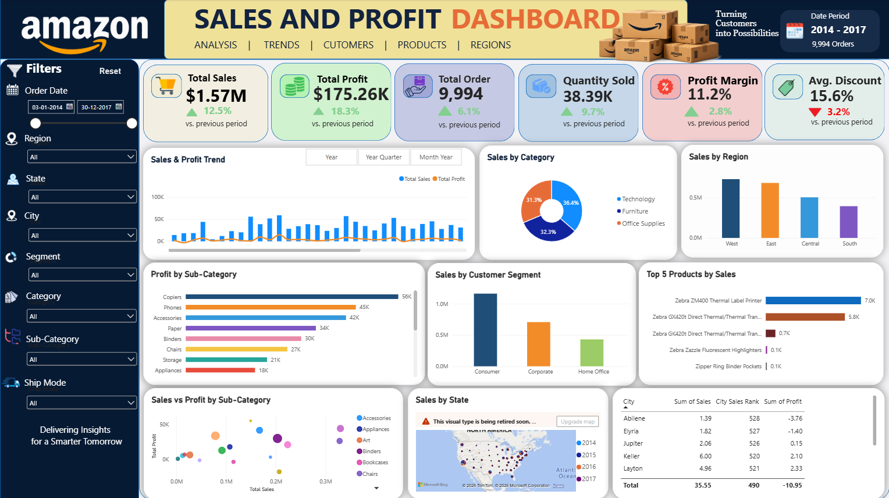

# Amazon Sales Analysis Dashboard

An interactive **Power BI sales analytics dashboard** built to explore retail order performance across time, geography, customer segments, products, discounts, and shipping modes.

The goal is to turn order-level data into a clear business view: **where sales value comes from, which products and regions contribute to profit, and where discounting or shipping decisions deserve closer investigation.**

## Dashboard Preview

[Open the dashboard screenshot](Dashboard.png)

## Project Overview

This project demonstrates a business intelligence workflow using an Excel dataset and Microsoft Power BI. The report brings key sales and profitability measures into one place and supports interactive filtering for more focused analysis.

### Tools Used

- **Microsoft Power BI Desktop** — data modelling, measures, visualisations, report layout, and interactive filtering.
- **Microsoft Excel (.xlsx)** — source dataset.
- **DAX** — calculations and time-based measures in Power BI.

## Why This Project Matters

Sales totals alone do not explain business performance. A high-revenue product may generate limited profit; discounts may increase sales volume while reducing margins; and regional performance can vary. A dashboard allows an analyst to explore these relationships without manually slicing rows in a spreadsheet.

This dashboard is intended to help investigate practical business questions:

- Are sales and profit increasing or decreasing over time?
- Which regions, states, and cities contribute most to sales and profit?
- Which product categories and sub-categories perform well?
- How do Consumer, Corporate, and Home Office segments compare?
- How are discount levels associated with profitability?
- How do shipping modes relate to order distribution and recorded shipment cost?
- Which areas merit further investigation before making pricing, inventory, or fulfilment decisions?

These are **exploratory questions, not claims of proven causation**. For example, discounts may coincide with lower profit, but further analysis is needed to separate their effect from product mix, order size, and other factors.

## Dataset

**File:** `Amazon Sales Dataset.xlsx`  
**Records:** 9,994 rows  
**Columns:** 20  
**Order-date coverage:** January 3, 2014 – December 30, 2017  
**Country represented:** United States  
**Missing values:** No missing values were detected in the supplied workbook during the initial check.

The workbook contains order-line-level sales records with fields covering dates, customers, products, geography, shipping, sales, quantity, discount, and profit.

### Column Dictionary

| Column | Description |
|---|---|
| `Order_id` | Identifier associated with an order. More than one row can belong to the same order. |
| `Order Date` | Date the order was placed. |
| `Ship Date` | Date the order was shipped. |
| `Ship Mode` | Shipping service class, such as Standard Class or First Class. |
| `Customer ID` | Customer identifier. |
| `Customer Name` | Customer name recorded in the dataset. |
| `Segment` | Customer segment: Consumer, Corporate, or Home Office. |
| `Country` | Country associated with the record. |
| `City` | City associated with the order. |
| `State` | State associated with the order. |
| `Region` | Broad geographic region. |
| `Product ID` | Product identifier. |
| `Category` | Broad product category. |
| `Sub-Category` | More specific product grouping. |
| `Product Name` | Product description or name. |
| `Sales` | Sales amount recorded for the row. |
| `Quantity` | Number of units recorded for the row. |
| `Discount %` | Discount value recorded for the row. |
| `Profit` | Profit value recorded for the row. |
| `Shipment Cost` | Shipment cost recorded for the row. |

**Important interpretation note:** The dataset has 9,994 rows but 5,009 distinct order IDs. Row count and order count are not interchangeable. Use a distinct count of `Order_id` for an order KPI rather than counting rows. Confirm the currency, discount scale, and shipment-cost definition before making financial or external comparisons; column names alone do not establish these definitions.

## Dataset Snapshot

The following summary values were calculated directly from the supplied workbook.

| Measure | Value |
|---|---:|
| Records (rows) | 9,994 |
| Distinct order IDs | 5,009 |
| Total sales | 2,297,200.86 |
| Total profit | 286,397.02 |
| Aggregate profit margin (total profit ÷ total sales) | 12.47% |
| Total quantity | 37,873 |
| Mean recorded discount value | 0.1562 |
| Mean shipment cost per row | 8.71 |

These figures are expressed in the dataset's recorded units. The workbook does not explicitly establish a currency label, so no currency symbol is added here. The mean discount is shown in its original numeric scale; verify whether the field uses decimal fractions or percentage points before displaying it as a percentage.

### Records by Product Category

| Category | Row count |
|---|---:|
| Office Supplies | 6,026 |
| Furniture | 2,121 |
| Technology | 1,847 |

These counts describe rows, not unique orders or revenue share.

## Dashboard Analysis Areas

Use the available slicers and visuals to explore:

- **Time-based performance:** compare sales, profit, and order activity across dates and periods.
- **Regional performance:** compare regions, states, and cities for geographic differences.
- **Product performance:** review categories and sub-categories for sales and profitability patterns.
- **Customer segments:** compare Consumer, Corporate, and Home Office records.
- **Discount and profit:** investigate whether higher discounts are associated with different profit outcomes.
- **Shipping:** explore shipping-mode mix and recorded shipment costs.

Report filters include order date, region, state, city, segment, category, sub-category, and ship mode. Applying filters helps isolate one business question at a time.

## Key Metrics and Definitions

The following definitions are recommended when interpreting or extending the report. Check the measures in the Power BI file to ensure they use the same logic.

| KPI | Suggested calculation | Why it helps |
|---|---|---|
| Total Sales | Sum of `Sales` | Measures recorded sales value. |
| Total Profit | Sum of `Profit` | Measures recorded profit. |
| Total Orders | Distinct count of `Order_id` | Avoids counting each order line as a separate order. |
| Quantity Sold | Sum of `Quantity` | Measures units recorded. |
| Profit Margin | Total Profit ÷ Total Sales | Shows profit relative to sales when sales are non-zero. |
| Average Discount | Average of `Discount %` | Summarises the row-level discount field; verify its scale first. |
| Previous-Period Change | (Current KPI − Previous-period KPI) ÷ Previous-period KPI | Adds context to a selected period; handle zero or blank prior values. |

For period comparisons, use a proper date table related to `Order Date`. Ensure that the comparison matches the selected reporting grain: month-over-month and year-over-year are different calculations.

## Data Preparation and Modelling Notes

The initial workbook check found 9,994 rows, 20 columns, and no missing values in the supplied fields. This is a useful starting point, but it does not replace validation of duplicates, data types, unusual values, or business rules.

Recommended checks when refreshing or extending the report:

1. Set `Order Date` and `Ship Date` to date data types.
2. Confirm that `Sales`, `Profit`, and `Shipment Cost` are numeric.
3. Validate the scale of `Discount %` (for example, whether `0.20` represents a 20% discount).
4. Use distinct order IDs for order counts and appropriate sums for row-level values.
5. Create a calendar/date table for consistent time intelligence.
6. Check that profit and shipment-cost fields are additive at the row grain and are not double-counted in visuals with different levels of detail.
7. Review duplicates and outliers using the dataset's business definitions before removing or changing records.

## How to Use the Project

1. Clone or download this repository.
2. Open `AMAZON SALES.pbix` in **Power BI Desktop**.
3. If prompted, update the Excel source path to the location of `Amazon Sales Dataset.xlsx`.
4. Refresh the data.
5. Use slicers to filter dates, region, state, city, segment, category, sub-category, and shipping mode.
6. Select visual elements to cross-filter the report and compare results.

If Power BI refers to a local file path, update it through **Transform data → Data source settings** or the relevant Power Query source step before refreshing.

## Repository Contents

| File | Purpose |
|---|---|
| `Dashboard.png` | Screenshot and preview of the dashboard. |
| `Amazon Sales Dataset.xlsx` | Excel source dataset. |
| `AMAZON SALES.pbix` | Power BI report file. |
| `README.md` | Project documentation. |

## Limitations

- The data covers 2014–2017 and should not be treated as a description of current retail performance.
- The dataset in this repository is an analytical dataset; it is not evidence of access to Amazon's live or internal systems.
- The column names alone do not confirm currency, accounting conventions, or the exact definition of shipment cost.
- Descriptive analysis can reveal patterns and correlations, but does not establish causation.
- Results depend on the data and measure definitions used in the workbook and Power BI model.

## Future Improvements

- Add a dedicated date table and validated month, quarter, and year comparisons.
- Add drill-through pages for product and geographic details.
- Add discount-versus-profit analysis with clear row-level and aggregate definitions.
- Add shipping lead time using `Ship Date − Order Date`.
- Add a data-quality page for outliers, duplicate checks, and metric definitions.
- Document validated findings from the dashboard rather than assuming trends in advance.

## Skills Demonstrated

**Power BI · Data Modelling · DAX · KPI Design · Data Visualisation · Business Analysis · Sales and Profitability Analysis · Interactive Reporting**

## Author

**Satya Ranjan Jena**  
GitHub: [XERA-03](https://github.com/XERA-03)

## Disclaimer

This is an independent data-analytics portfolio project created for learning and demonstration. It is not affiliated with or endorsed by Amazon. Dataset figures and analyses describe only the workbook included in this repository.
